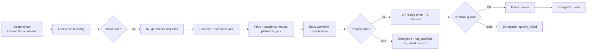

# Prospection B2B automatisée avec n8n et l'IA

> Date de création : 2026-10-24
> Auteur : Vladimir Pilioua
> Dernière mise à jour : 2026-10-31
> Statut : prototype fonctionnel, en mode test (projet scolaire)

## À propos

Ce projet automatise la **prospection commerciale par email** pour une activité de vente de **systèmes speed-to-lead** : des automatisations qui recontactent en quelques minutes un prospect qui vient de remplir un formulaire, au lieu de le laisser attendre des heures.

Chaque jour, le robot :

1. **cherche** sur le web des entrepreneurs qui vendent via les réseaux sociaux (coachs, consultants, formateurs, infopreneurs) ;
2. **lit leur site** et demande à une IA de juger s'ils correspondent à la cible, avec un score sur 100 ;
3. **trouve et vérifie** l'email du décideur ;
4. **rédige** un email personnalisé et deux relances ;
5. **contrôle** chaque email avant de l'envoyer depuis Gmail ;
6. **relance** à J+3 et J+7, et s'arrête dès que le prospect répond ou demande à ne plus être contacté.

Principe de conception : **le moins d'IA possible**. Toutes les étapes qu'on peut écrire à l'avance sont automatisées de façon fixe et prévisible. L'IA n'intervient qu'aux trois endroits où il faut du jugement : inventer les recherches, qualifier une entreprise, rédiger les emails.

## Table des matières

- 🧭 [Fonctionnement](#fonctionnement)
- 📋 [Prérequis](#prérequis)
- 🛠️ [Installation](#installation)
- ▶️ [Utilisation](#utilisation)
- ⚙️ [Configuration](#configuration)
- 🗃️ [Données](#données)
- 🛡️ [Garde-fous](#garde-fous)
- 🧱 [Construit avec](#construit-avec)
- 📁 [Arborescence du projet](#arborescence-du-projet)
- ⚠️ [Limites connues](#limites-connues)
- 🩺 [Dépannage](#dépannage)
- 🏷️ [Gestion des versions](#gestion-des-versions)
- 📄 [Licence](#licence)

## Fonctionnement

### Vue d'ensemble



Le système est découpé en plusieurs workflows n8n, chacun avec une seule responsabilité.

### Les workflows

| Workflow | Déclencheur | Rôle |
|---|---|---|
| **Prospection Setup** | Manuel, une seule fois | Crée les deux tables de données et la ligne de configuration |
| **Prospection Daily Run** | Lun-ven à 9 h, manuel, ou appelé par Run Now | Pipeline principal : recherche, qualification, rédaction, contrôle, envoi |
| **Prospection Qualify Company** | Appelé par Daily Run | Lit un site, le fait noter par l'IA, trouve et vérifie l'email du décideur |
| **Prospection Follow Ups** | Lun-ven à 10 h ou manuel | Détecte les réponses et envoie les relances |
| **Prospection Error Handler** | Échec d'un autre workflow | Envoie un email d'alerte avec le lien vers l'exécution en échec |
| **Prospection Run Now** | Manuel | Lance Daily Run à la demande, en un clic |

### Détail des étapes

**1. Recherche (Daily Run)**
- Gemini génère 5 requêtes de recherche variées à partir de la cible décrite dans la config.
- Firecrawl exécute chaque requête (10 résultats par requête).
- Un code fixe extrait le nom de domaine de chaque résultat, puis retire les médias, annuaires, réseaux sociaux et sites d'emploi (liste de plus de 60 domaines). Il retire aussi les domaines déjà présents dans la base et les doublons.
- Seuls **4 fois le quota restant du jour** sont envoyés en qualification (par exemple 8 candidats pour un plafond de 2), car beaucoup sont écartés.

**2. Qualification (Qualify Company)**
- Une pause de 7 secondes respecte la limite de vitesse du plan gratuit Firecrawl.
- Firecrawl lit la page d'accueil du site au format texte (délai maximum : 60 secondes).
- Gemini analyse le site et renvoie une réponse structurée : site d'entreprise ou non, nom, secteur, résumé, fait d'accroche pour personnaliser l'email, score de 0 à 100 et justification.
- Un code fixe décide : l'entreprise est retenue si c'est un vrai site d'entreprise et si le score atteint `minScore`.
- Hunter cherche les emails nominatifs du domaine. Un code choisit le meilleur contact : d'abord le poste (fondateur, CEO…), puis l'ancienneté, puis la confiance de Hunter (70 % minimum).
- Hunter vérifie l'adresse. Seul le statut **valid** permet l'envoi.

**3. Rédaction et contrôle (Daily Run)**
- Gemini écrit en un seul appel l'objet, le premier email (60 à 120 mots) et les deux relances. Les relances sont donc écrites dès le départ et ne demandent plus d'IA ensuite.
- Le contrôle qualité vérifie la longueur, l'absence de texte à compléter, de lien, de tutoiement et de mention de l'IA, et la présence de la salutation. Il ajoute la signature et la ligne de désinscription obligatoire.
- Gmail envoie l'email. La ligne n'est marquée `sent` que si Gmail renvoie un identifiant de message ; sinon elle passe en `send_error` avec le message d'erreur.

**4. Relances (Follow Ups)**
- Le workflow lit le fil Gmail de chaque séquence ouverte.
- Tout message qui n'a pas été envoyé par nous arrête la séquence : `replied`, `opt_out` (mots « STOP », « désinscrire »…) ou `bounced` (rebond).
- Sinon, il envoie la relance 1 à J+3, puis la relance 2 à J+7, en réponse dans le même fil.

## Prérequis

| Outil | Usage | Lien |
|---|---|---|
| **n8n** (Cloud ou auto-hébergé, version 2.x) | Moteur qui exécute les workflows | [docs.n8n.io](https://docs.n8n.io) |
| **Node.js** 20 ou plus | Nécessaire pour n8ncli | [nodejs.org](https://nodejs.org) |
| **n8ncli** | Gère les workflows sous forme de code (TypeScript) | [npm : @workflows-accelerator/n8n-cli](https://www.npmjs.com/package/@workflows-accelerator/n8n-cli) |
| **Compte Google AI Studio** | Clé API Gemini | [aistudio.google.com](https://aistudio.google.com) |
| **Compte Firecrawl** | Recherche web et lecture des sites (plan gratuit) | [firecrawl.dev](https://www.firecrawl.dev) |
| **Compte Hunter** | Recherche et vérification d'emails (plan gratuit) | [hunter.io](https://hunter.io) |
| **Compte Gmail** | Envoi des emails et lecture des réponses | [gmail.com](https://mail.google.com) |

## Installation

### 1. Installer n8ncli et relier le projet à n8n

```bash
npm install -g @workflows-accelerator/n8n-cli
cd projet-prospection-n8n
n8ncli init --url "https://<votre-instance>.app.n8n.cloud" --project-id <ID_DU_PROJET>
n8ncli projects   # vérifie la connexion et affiche l'ID du projet
```

### 2. Créer les workflows sur l'instance

Les fichiers se trouvent dans `n8n/workflows/`. Respectez cet ordre : un workflow qui en appelle un autre a besoin de son identifiant.

```bash
n8ncli validate "n8n/workflows/Prospection Setup.workflow.ts"
n8ncli push "n8n/workflows/Prospection Setup.workflow.ts"
n8ncli push "n8n/workflows/Prospection Qualify Company.workflow.ts"
n8ncli push "n8n/workflows/Prospection Error Handler.workflow.ts"
n8ncli push "n8n/workflows/Prospection Daily Run.workflow.ts"
n8ncli push "n8n/workflows/Prospection Follow Ups.workflow.ts"
n8ncli push "n8n/workflows/Prospection Run Now.workflow.ts"
```

Sur une nouvelle instance, remplacez dans Daily Run l'identifiant de Qualify Company (bloc `Qualify Company`), et dans Run Now l'identifiant de Daily Run, par ceux affichés lors du `push`.

### 3. Créer les tables

Lancez une seule fois **Prospection Setup**. Les tables doivent exister avant de pousser Daily Run et Follow Ups : n8n vérifie les tables référencées dès la création d'un workflow.

```bash
n8ncli exec <ID_DE_PROSPECTION_SETUP> --mode manual
```

### 4. Brancher les comptes (dans l'interface n8n)

| Bloc | Compte |
|---|---|
| Gemini Query Model, Gemini Writer Model, Gemini Qualify Model | Google Gemini (clé API) |
| Find Companies, Scrape Website | Firecrawl (clé API commençant par `fc-`) |
| Find Decision Makers, Verify Email | Hunter (clé API) |
| Send Email, Get Thread, Send Follow Up, Send Alert | Gmail (connexion OAuth « Sign in with Google ») |

### 5. Régler chaque workflow planifié

Dans **Daily Run**, **Follow Ups** et **Qualify Company** (⋯ → Settings) :
- **Timezone** : `Europe/Paris`
- **Error workflow** : `Prospection Error Handler`

Ces réglages doivent être faits à la main : le serveur MCP de n8n refuse de les modifier à distance.

## Utilisation

### Lancer une campagne à la demande

- Ouvrir **Prospection Run Now** puis cliquer sur **Execute workflow**,
- ou ouvrir **Prospection Daily Run** puis cliquer sur **Execute workflow**.

Un lancement dure de 3 à 8 minutes. Les résultats apparaissent dans la table **Prospection Prospects**, et en mode test les emails arrivent sur l'adresse `testEmail`.

### Lancer automatiquement chaque jour

Publier **Prospection Qualify Company** (déjà fait), **Prospection Error Handler**, **Prospection Daily Run** puis **Prospection Follow Ups**. Le robot tourne alors du lundi au vendredi : recherche et envois à 9 h, relances à 10 h.

### Arrêter le robot

Décocher `active` dans la config. Les deux workflows planifiés s'arrêtent au passage suivant.

### Retraiter une entreprise

Supprimer sa ligne dans la table **Prospection Prospects** : elle sera de nouveau candidate au lancement suivant. Les lignes en `error` sont retentées automatiquement.

### Commandes utiles

```bash
n8ncli pull                 # récupère la dernière version des workflows
n8ncli status               # liste les changements locaux à envoyer
n8ncli validate <fichier>   # vérifie un workflow avant envoi
n8ncli push <fichier>       # envoie un workflow sur l'instance
n8ncli exec <id> --mode manual   # lance un workflow qui n'a qu'un déclencheur
```

## Configuration

Toute la configuration se trouve dans la table **Prospection Config** (une seule ligne). Elle se modifie depuis l'onglet **Data tables** de n8n, sans toucher aux workflows.

| Champ | Type | Rôle | Valeur actuelle |
|---|---|---|---|
| `active` | booléen | Interrupteur général | coché |
| `testMode` | booléen | Coché : tous les emails partent vers `testEmail` | coché |
| `testEmail` | texte | Destinataire des tests et des alertes | adresse personnelle de l'auteur |
| `offer` | texte | Description de l'offre, utilisée pour qualifier et rédiger | offre speed-to-lead |
| `targetDescription` | texte | Description de la cible | entrepreneurs francophones vendant via les réseaux |
| `decisionMakerRoles` | texte | Postes recherchés, séparés par des virgules | fondateur, founder, ceo, gérant… |
| `searchCountry` | texte | Pays de recherche | FR |
| `senderName`, `senderTitle`, `senderWebsite` | texte | Signature des emails | renseignés |
| `dailyLimit` | nombre | Nombre maximum de premiers emails par jour | 2 à 4 |
| `searchQueries` | nombre | Nombre de requêtes de recherche par lancement | 5 |
| `minScore` | nombre | Score minimum pour retenir une entreprise (sur 100) | 60 |

## Données

### Table Prospection Prospects

Une ligne par nom de domaine. Un domaine présent dans la table n'est **jamais recontacté**, sauf s'il est en `error`.

| Colonne | Description |
|---|---|
| `domain` | Nom de domaine de l'entreprise (clé d'unicité) |
| `companyName`, `websiteUrl` | Nom et site de l'entreprise |
| `status` | Étape atteinte (voir ci-dessous) |
| `reason` | Explication : justification de l'IA, motif de refus ou message d'erreur |
| `score` | Score d'adéquation donné par l'IA (0 à 100) |
| `summary` | Résumé de l'activité de l'entreprise |
| `contactName`, `contactTitle` | Nom et poste du décideur (vides si Hunter ne les fournit pas) |
| `email`, `emailStatus` | Email du décideur et résultat de la vérification Hunter |
| `sentTo` | Adresse à laquelle l'email est réellement parti (`testEmail` en mode test) |
| `subject`, `email1`, `followUp1`, `followUp2` | Objet et textes complets de la séquence |
| `threadId`, `lastMessageId` | Identifiants Gmail, utilisés pour les relances |
| `firstSentAt`, `lastActionAt` | Date du premier envoi et de la dernière action (UTC) |
| `sentCount` | Nombre d'emails envoyés dans la séquence |
| `testMode` | Indique si l'envoi a eu lieu en mode test |

### Statuts

| Statut | Signification | Contacté ? |
|---|---|---|
| `not_qualified` | Ne correspond pas à la cible, ou n'est pas un site d'entreprise | Non |
| `no_email` | Aucun email de décideur fiable et vérifié | Non |
| `error` | Site illisible ou échec technique (retenté au lancement suivant) | Non |
| `quality_failed` | Email bloqué par le contrôle qualité | Non |
| `send_error` | Gmail n'a pas confirmé l'envoi | Non |
| `sent` | Premier email envoyé | Oui |
| `followed_up_1` | Relance 1 envoyée | Oui |
| `completed` | Relance 2 envoyée, séquence terminée | Oui |
| `replied`, `opt_out`, `bounced` | Réponse, désinscription ou rebond : séquence arrêtée | Oui |

## Garde-fous

| Risque | Protection |
|---|---|
| Envoyer à de vraies personnes pendant les tests | `testMode` redirige tous les emails vers `testEmail` et préfixe l'objet par `[TEST pour …]` |
| Être considéré comme du spam | Plafond journalier `dailyLimit` ; une seule séquence par entreprise |
| Écrire à une mauvaise adresse | Seuls les emails vérifiés **valid** par Hunter sont utilisés |
| Email mal rédigé ou incomplet | Contrôle qualité fixe avant chaque envoi |
| Instructions cachées dans un site web | Le contenu des sites est traité comme une donnée ; l'IA a l'ordre d'ignorer toute instruction qu'il contient |
| Non-respect des règles CNIL (prospection B2B) | Expéditeur identifié, ligne « répondez STOP » dans chaque email, arrêt immédiat en cas de réponse |
| Erreur silencieuse | Chaque issue est enregistrée avec sa raison ; Error Handler envoie une alerte par email |
| Emballement | Interrupteur `active` |

## Construit avec

### Plateforme

- [**n8n**](https://n8n.io) : plateforme d'automatisation qui exécute les workflows. Les tables de données n8n (Data Tables) servent de base de données.
- [**n8ncli**](https://www.npmjs.com/package/@workflows-accelerator/n8n-cli) : gestion des workflows sous forme de fichiers TypeScript (`@n8n/workflow-sdk`), avec validation, envoi et récupération.

### Services externes

| Service | Usage | Modèle ou plan |
|---|---|---|
| [Google Gemini](https://ai.google.dev) | Génération des requêtes, qualification, rédaction | `gemini-flash-lite-latest` |
| [Firecrawl](https://www.firecrawl.dev) | Recherche web et lecture des sites | Plan gratuit (clé API personnelle) |
| [Hunter](https://hunter.io) | Recherche et vérification des emails | Plan gratuit |
| [Gmail](https://developers.google.com/gmail/api) | Envoi, lecture des fils, alertes | Compte connecté en OAuth |

## Arborescence du projet

```
projet-prospection-n8n/
├── README.md
└── n8n/
    └── workflows/
        ├── Prospection Setup.workflow.ts            # création des tables et de la config
        ├── Prospection Daily Run.workflow.ts        # pipeline principal
        ├── Prospection Qualify Company.workflow.ts  # sous-workflow de qualification
        ├── Prospection Follow Ups.workflow.ts       # relances et détection des réponses
        ├── Prospection Error Handler.workflow.ts    # alertes en cas d'échec
        └── Prospection Run Now.workflow.ts          # lancement à la demande
```

Chaque fichier `.workflow.ts` décrit un workflow n8n avec le SDK `@n8n/workflow-sdk`. Il s'envoie sur une instance n8n avec `n8ncli push` (voir [Installation](#installation)).

## Limites connues

- **Relances non testées en conditions réelles** : la détection des réponses et l'envoi des relances n'ont été testés que sur le papier. En mode test, une réponse écrite depuis sa propre adresse n'est pas détectée (elle est vue comme « envoyée par nous »).
- **Quotas gratuits** : environ 25 recherches Hunter par mois, soit 1 à 2 prospects contactés par jour au maximum sans abonnement.
- **Hébergement** : l'essai gratuit de n8n Cloud expire début novembre 2026. Il faut ensuite un abonnement, ou installer n8n gratuitement sur sa propre machine.
- **Adresse d'envoi** : les emails partent du compte Gmail connecté (actuellement une adresse scolaire). Pour un usage réel, il faut un compte dédié.
- **Jour du plafond** : le compteur `dailyLimit` repart à zéro à minuit UTC (1 h ou 2 h du matin en France).
- **Contacts sans nom** : quand Hunter ne fournit pas le prénom, l'email commence par « Bonjour, ».

## Dépannage

| Symptôme | Cause probable | Solution |
|---|---|---|
| Aucun email reçu, tout est vert | Plafond du jour atteint (`Build Candidates` ne renvoie rien) | Augmenter `dailyLimit` ou attendre le lendemain |
| `Qualify Company` reçoit « No data » | Aucun nouveau candidat après filtrage | Élargir `targetDescription`, vérifier les résultats de `Find Companies` |
| Beaucoup de `not_qualified` | Offre ou cible mal décrite, ou `minScore` trop haut | Préciser la config, baisser `minScore` |
| Beaucoup de `error` « Site illisible » | Limite Firecrawl ou site protégé | Vérifier les crédits Firecrawl ; les lignes sont retentées automatiquement |
| « Resource not found » sur un bloc Gemini | Modèle Gemini retiré par Google | Choisir un modèle disponible dans le bloc (ex. `gemini-flash-lite-latest`) |
| « Authorization failed » | Clé API invalide | Recoller la clé dans le credential concerné |
| Emails introuvables dans Gmail | Mauvais compte consulté | Chercher dans les « Messages envoyés » du compte connecté à n8n |

## Gestion des versions

Les versions suivent la [gestion sémantique de version](https://semver.org/lang/fr/).

| Version | Date | Changements |
|---|---|---|
| 1.0.0 | 2026-10-31 | Premier prototype fonctionnel de bout en bout en mode test : recherche Firecrawl (à la place de Brave Search, payant), modèle Gemini `flash-lite`, barème de notation explicite, filtre « B2B » retiré pour coller à la cible, pause et délai Firecrawl, contrôle d'envoi Gmail fiable, accents corrigés, déclencheur Run Now |

## Licence

Projet réalisé dans un cadre scolaire. Aucune licence d'utilisation n'est accordée à ce jour. n8n est distribué sous sa propre licence ([Sustainable Use License](https://docs.n8n.io/sustainable-use-license/)).
